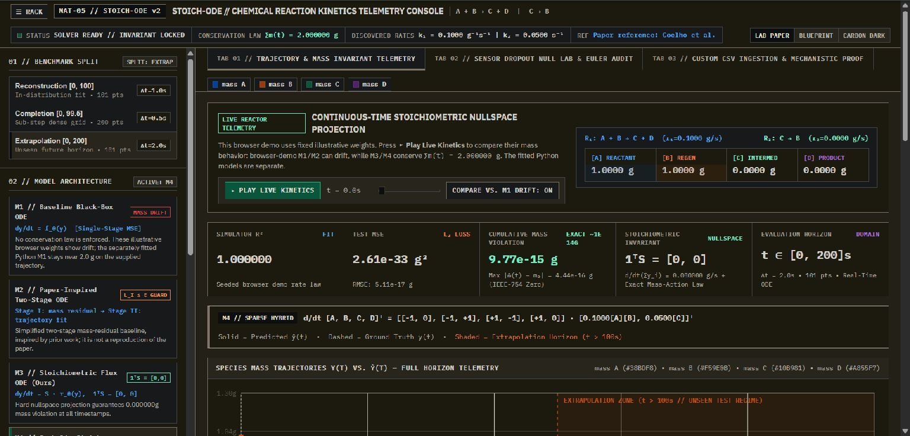
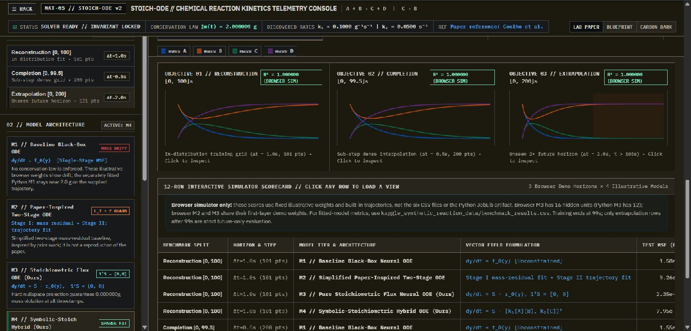
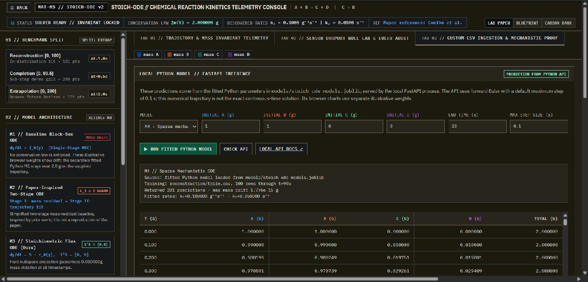

# STOICH-ODE — Reaction Kinetics Console

[](https://www.python.org/)
[](https://fastapi.tiangolo.com/)
[](LICENSE)
[](https://jithu2517-stack.github.io/Stoich-Ode/)

An interactive reaction-kinetics console and four-model ODE benchmark. It includes a static browser simulator, a local FastAPI endpoint backed by fitted Python models, and six supplied synthetic CSV files for reconstruction, completion, and extrapolation.

**[Open the live browser demo](https://jithu2517-stack.github.io/Stoich-Ode/)** · **[Run the fitted Python models locally](#run-the-local-python-api)**

## Screenshots

These screenshots show the interface without requiring a local setup.







## What runs in the browser and what runs in Python

GitHub Pages serves the static console only. Its simulator uses fixed illustrative parameters embedded in the HTML and built-in trajectories. Those browser parameters are **not exported from** `models/stoich_ode_models.joblib`, and their training provenance is not recorded. The browser M3 uses 16 hidden units while Python M3 uses 12; browser M2 and M3 also share their first-layer demo weights. The browser's visible M1 drift is therefore an illustration, not the result of the fitted Python M1.

The local FastAPI panel loads the fitted parameters from the Joblib file. On the supplied Python benchmark trajectory, M1's maximum mass violation is about `2.55e-10 g` (mass drift stays around `1e-8 g` in the aggregate metric). The model does not enforce conservation as a structural constraint, so this result does not guarantee conservation for other initial states or trajectories.

## Python benchmark results

These scores were generated by `python train_stoich_ode.py` from the included CSVs. Training uses `reconstruction/train.csv`, which covers `t = 0` to `99 s`. The strict future-only scores below use only extrapolation test rows with `t > 99 s`.

| Model | Full extrapolation CSV R² | Future-only R² (`t > 99 s`) | Future-only RMSE (g) |
| --- | ---: | ---: | ---: |
| M1 — Unconstrained MLP ODE | 0.982950 | -73.804846 | 0.025912 |
| M2 — Simplified two-stage baseline | -17.161904 | -55,704.602992 | 0.707106 |
| M3 — Stoichiometric flux ODE | 0.999865 | 0.978171 | 0.000443 |
| M4 — Sparse mechanistic fit | 1.000000 | 1.000000 | 1.06e-16 |

R² is a coefficient of determination, not an accuracy percentage; it can be negative when predictions are worse than predicting the sample mean. The complete metrics for every split are in [`benchmark_results.csv`](kaggle_synthetic_reaction_data/benchmark_results.csv).

### Why M4 scores 1.0 here

The supplied data is clean synthetic data generated with forward Euler steps. M4's candidate features include the true rate laws (`A*B` and `C`), and it uses the same Euler update. Recovering the rates and matching the synthetic benchmark nearly exactly is expected; it is not evidence that M4 generalizes to unknown chemistry.

A seeded sensitivity check adds independent Gaussian measurement noise with standard deviation `0.02 g` to each training measurement (1% of the initial total mass of `2 g`), then evaluates the fitted model on the clean strict future-only extrapolation rows. Future-only RMSE rises from about `1.06e-16 g` on clean training data to `0.0271 g`; the noisy fit also activates extra candidate terms. This is one reproducible perturbation, not a broad robustness estimate. For a different reaction, the candidate features and stoichiometry must be reconsidered and validated.

### Euler step size

The API integrates with forward Euler. Its default maximum step is `0.1 s`, which gives M4 `A(20 s) ≈ 0.2634 g`; a step of `1 s` gives about `0.2541 g`. A high-accuracy continuous-time solution is about `0.2644 g`. The discrete result depends on step size, and smaller steps converge toward the continuous solution. The API's interval limit is 2,000 steps.

### Browser scorecard

The in-page R² badges are labeled **“browser sim”** because they are recalculated against the console's built-in simulator trajectories. They are not read from the CSVs or the fitted Joblib model. Use the table above and `benchmark_results.csv` for Python benchmark results.

## Models

- **M1 — Unconstrained MLP ODE:** fits species derivatives with a small neural network. It has no built-in mass-conservation guarantee. The checked-in Python fit happens to conserve mass closely on the supplied trajectory.
- **M2 — Simplified two-stage baseline:** paper-inspired mass-residual and trajectory fitting. It is not a faithful reproduction of Coelho et al.'s method.
- **M3 — Stoichiometric flux ODE:** predicts reaction fluxes and projects them through the stoichiometric matrix. Since each column of `S` sums to zero, mass conservation is structural.
- **M4 — Sparse mechanistic fit:** estimates fluxes from finite differences and fits a candidate feature set with thresholded least squares. On this dataset, its features contain the generating rate laws.

The supplied reaction system is `A + B -> C + D` and `C -> B`, with initial state `[1, 1, 0, 0]`.

## Dataset and evaluation scope

The repository contains six CSV files attributed by the supplied archive to the [Kaggle Synthetic Chemical Reaction dataset](https://www.kaggle.com/datasets/cici118/synthetic-chemical-reaction). This project uses those checked-in files and does not fetch a fresh copy. The benchmark runner does not overwrite them.

The three training CSVs are byte-for-byte identical, and `reconstruction/test.csv` is identical to them. Reconstruction is therefore in-sample, not an independent test. The completion test has 200 rows from `0` through `99.5 s`; it does not extend the training horizon. Each supplied task shares one deterministic initial condition and trajectory. These results do not establish generalization to new reactions, initial conditions, or experimental data.

The sensor-dropout audit injects eight single-sensor gaps and two double-sensor gaps into a temporary copy of the training data. It measures recovered values returned by `load_and_clean_csv`: eight are imputed from mass balance, and two rows with multiple missing sensors are dropped. This checks the loader's behavior on this synthetic example; it is not a general sensor-recovery guarantee.

## Run the local Python API

**Windows:** double-click `run_local.bat`. It creates a virtual environment, installs the runtime dependencies, trains the models if the Joblib artifact is missing, and starts the local server.

**Any platform:**

```bash
python -m venv .venv
# Windows PowerShell: .venv\Scripts\Activate.ps1
# macOS/Linux:        source .venv/bin/activate
python -m pip install -r requirements.txt
python train_stoich_ode.py
python -m uvicorn api:app --host 127.0.0.1 --port 8001
```

Open [http://127.0.0.1:8001](http://127.0.0.1:8001), then go to **TAB 03** and choose **Local Python Model**. The local API documentation is at [http://127.0.0.1:8001/docs](http://127.0.0.1:8001/docs). For iterative development only, add `--reload` to the Uvicorn command.

The API binds to `127.0.0.1` and is intended for local demonstration and development. It has no authentication or CORS configuration and is not a production service. Predictions are not clamped to non-negative values; if a model returns a materially negative species mass, the API response includes a warning and the UI displays it.

### API example

```bash
curl -X POST http://127.0.0.1:8001/api/predict \
  -H "Content-Type: application/json" \
  -d '{"model":"M4","initial_state":[1,1,0,0],"start_time":0,"end_time":20,"step_size":0.1}'
```

The response includes the predictions, maximum mass drift, minimum predicted species mass, any negative-mass warnings, and training provenance. M4 also returns its fitted rates. Supported model IDs are `M1`, `M2`, `M3`, and `M4`. `step_size` is the maximum interval between returned rows; the API adjusts the grid so the final row lands exactly at `end_time`.

### Retrain the models

Run `python train_stoich_ode.py` to fit all four models from `kaggle_synthetic_reaction_data/reconstruction/train.csv`. The runner validates the supplied CSVs and refreshes `models/stoich_ode_models.joblib` and `kaggle_synthetic_reaction_data/benchmark_results.csv`. Optional demo data generation only runs when explicitly requested:

```bash
python train_stoich_ode.py --generate-demo-data
```

Existing CSV files are left unchanged. Generated files mirror the project equations and are not fetched Kaggle data.

## Tests

Install the development dependencies and run the small API, data-audit, and seeded noise checks:

```bash
python -m pip install -r requirements-dev.txt
python -m pytest -q
```

## Repository files

```text
index.html                                             # GitHub Pages console
stoich_ode_chemical_reaction_kinetics_telemetry_console.html  # identical compatibility copy
api.py                                                 # local FastAPI service
train_stoich_ode.py                                    # training, benchmark, and audits
requirements.txt                                       # runtime dependencies
requirements-dev.txt                                   # test dependencies
run_local.bat                                          # Windows local launcher
models/stoich_ode_models.joblib                        # fitted Python parameters
kaggle_synthetic_reaction_data/                        # supplied CSVs and benchmark results
tests/                                                 # pytest API and noise checks
screenshots/                                           # console screenshots used above
LICENSE                                                # MIT License
```

## References

- Coelho, Costa & Ferrás, *Prior knowledge meets Neural ODEs: a two-stage training method for improved explainability*, [OpenReview](https://openreview.net/pdf?id=p7sHcNt_tqo). M2 here is a simplified, paper-inspired baseline, not a reproduction.
- [Kaggle dataset attribution carried by the supplied archive](https://www.kaggle.com/datasets/cici118/synthetic-chemical-reaction).

## Author

Solo project by [@jithu2517-stack](https://github.com/jithu2517-stack). The historical commit attributed to [@Akshayzillah](https://github.com/Akshayzillah) is also mine.

## License

This project is licensed under the [MIT License](LICENSE).
